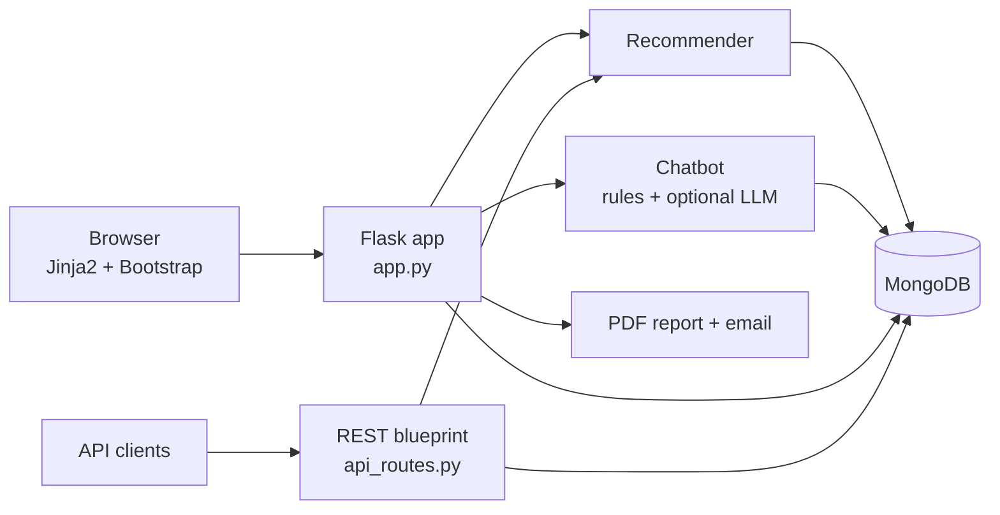

# MHT-CET College Recommendation & Enquiry System

**A Flask + MongoDB web app that helps Maharashtra engineering aspirants find, compare, and ask questions about colleges based on their MHT-CET percentile.**

[](https://github.com/Visheshmak/college-recommendation-system/actions/workflows/ci-cd.yml)


## Features

- **Personalised recommendations**: ranks colleges by admission chance and match score. The inputs are the student's percentile, category, preferred branch, and city, compared against historical cutoffs (`recommender.py`).
- **College enquiry chatbot**: rule-based intent matching. An optional LLM layer (Groq, OpenAI, or local Ollama) and an advanced mode answer from college websites (`advanced_chatbot.py`, `web_scraper.py`).
- **Search and comparison**: filter by city, branch, fees, and rating, and compare colleges side by side.
- **User accounts**: registration and login with Flask-Login, Werkzeug password hashing, a personal dashboard, and saved colleges.
- **PDF reports**: generates a recommendation report with ReportLab and can email it via Flask-Mail.
- **REST API**: `/api/colleges`, `/api/college/<name>`, `/api/search`, `/api/recommend`, `/api/saved-colleges`, `/api/health`, with input validation and per-client rate limiting.
- **Admin panel** for managing college data.

## Architecture



## Tech stack

**Backend:** Python, Flask, Flask-Login, Flask-WTF, Flask-Mail · **Database:** MongoDB (PyMongo) · **AI:** Groq / OpenAI / Ollama (optional) · **Other:** ReportLab, BeautifulSoup · **Frontend:** Jinja2, Bootstrap · **Quality:** pytest, mongomock, flake8, GitHub Actions

## Getting started

Prerequisites: Python 3.10+ and a MongoDB instance (local or Atlas).

```bash
git clone https://github.com/Visheshmak/college-recommendation-system.git
cd college-recommendation-system/college_recommendation_chatbot

python -m venv .venv
source .venv/bin/activate        # Windows: .venv\Scripts\activate
pip install -r requirements.txt

cp .env.example .env             # set MONGODB_URI, SECRET_KEY, mail and optional LLM settings
python db_init.py                # seed college data
python app.py                    # http://localhost:5000
```

### Configuration

| Variable | Purpose |
| --- | --- |
| `MONGODB_URI` | MongoDB connection string (default `mongodb://localhost:27017`) |
| `MAIL_SERVER`, `MAIL_PORT`, `MAIL_USERNAME`, `MAIL_PASSWORD`, `MAIL_DEFAULT_SENDER` | SMTP settings for emailing reports |
| `USE_LLM`, `LLM_PROVIDER`, `LLM_MODEL`, `LLM_API_KEY`, `OLLAMA_URL` | Optional LLM-backed chatbot answers |

## Testing

```bash
pip install -r college_recommendation_chatbot/requirements-dev.txt
pytest                           # run from the repository root; needs MongoDB on localhost:27017
```

CI runs flake8 and the pytest suite on Python 3.10, 3.11, and 3.12 with a MongoDB service container.

## Project structure

```text
college_recommendation_chatbot/
  app.py                 Flask app: pages, auth, recommendations, reports, admin
  api_routes.py          REST API blueprint
  recommender.py         admission-chance and match-score logic
  chatbot_logic.py       rule-based chatbot
  advanced_chatbot.py    chatbot backed by scraped college information
  llm_integration.py     Groq / OpenAI / Ollama providers
  report_generator.py    PDF reports
  email_service.py       report delivery
  validators.py          input validation and rate limiting
  mongo_db.py            database connection and collections
  templates/, static/    UI
  tests/                 pytest suite
```

More docs: [API](API_DOCUMENTATION.md) · [Database schema](DATABASE_SCHEMA.md) · [Deployment](DEPLOYMENT.md) · [Contributing](CONTRIBUTING.md)

## License

[MIT](LICENSE)
